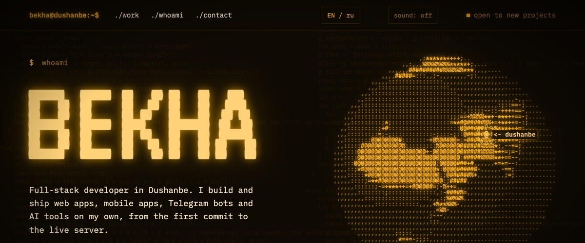

### Behruz Nabizoda (Bekha), full-stack developer in Dushanbe, Tajikistan

I build products on my own, from the first commit to the live server: mobile apps on Expo, web apps on React and Next.js, Supabase backends, Reddit games, AI tools. 15 shipped, several running for real businesses in Tajikistan.

**Open to remote work and freelance projects.** The fastest way to reach me is [Telegram](https://t.me/sabr_sf0).

[Portfolio](https://pythonhack000.github.io) · [LinkedIn](https://www.linkedin.com/in/behruz-nabizoda-669491238/) · [Telegram](https://t.me/sabr_sf0) · [Email](mailto:pythonhack000@gmail.com)

---

### Space and data

| Project | What it does | Stack |
|---|---|---|
| [**Lunar Site Navigator**](https://github.com/pythonhack000/lunar-navigator) · [live](https://pythonhack000.github.io/lunar-navigator/) | NASA Space Apps 2026. Pick any spot on the Moon and any date, see where the Sun and Earth sit above the real terrain horizon. | React, three.js, NASA LRO data |
| [**SPHEREx Blink**](https://github.com/pythonhack000/spherex-blink) · [live](https://pythonhack000.github.io/spherex-blink/) | NASA Space Apps 2026. Plays SPHEREx exposures of a sky position like a video, so moving objects stand out. | Python, JavaScript |

### Games

| Project | What it does | Stack |
|---|---|---|
| [**Feudlands**](https://github.com/pythonhack000/feudlands) · [play](https://www.reddit.com/r/feudlands_dev/comments/1y4sw8n/feudlands_day_1_cats_or_dogs_pick_a_side_and_take/) | A daily war over a hand-drawn island inside a Reddit post. The whole subreddit fights for one map. | Devvit Web, TypeScript |
| [**Crumple**](https://github.com/pythonhack000/crumple) | A daily trick-shot puzzle in ballpoint pen. Every miss stays on a table shared by all players. | Phaser, Devvit |

### Products

| Project | What it does | Stack |
|---|---|---|
| [**Page 100**](https://github.com/pythonhack000/page-100) · [live](https://pythonhack000.github.io/page-100/) | Teletext, resurrected: news, weather and rates at about 1 KB a page, for 2G networks. | TypeScript, Vite |
| [**Answering Machine**](https://github.com/pythonhack000/answering-machine) · [live](https://pythonhack000.github.io/answering-machine/) | A call link that screens strangers, flags scams and takes a confirmed callback number. | Web, AI |
| [**TRADEBOARD**](https://github.com/pythonhack000/tradevision) · [live](https://pythonhack000.github.io/tradevision/) | An AI chat that draws trendlines and zones on a live chart while it explains them. | React, TypeScript, LLMs |
| **Smart Canteen** | Lunch ordering app for a university canteen, with bonuses and live order status. | Expo, React Native, Supabase |
| [**AccBozor**](https://github.com/pythonhack000/bozor) · [live](https://pythonhack000.github.io/bozor/) | Game and Steam account marketplace for Tajikistan, with escrow. | Next.js, Supabase |
| **Store POS** | Desktop till, stock and manager for a shop in Dushanbe, replacing three Windows programs. | Electron, React, PostgreSQL |
| [**BYSABR**](https://github.com/pythonhack000/bysabr-shop) · [live](https://pythonhack000.github.io/bysabr-shop/) | Fashion store with catalog, checkout and an admin panel. | JavaScript, Supabase |
| [**Takhtabozor**](https://github.com/pythonhack000/takhtabozor) · [live](https://pythonhack000.github.io/takhtabozor/) | Stock, sales and customer debts for a timber yard. | React, Vite, Tailwind |

All 15 projects, with live previews, are on [the portfolio](https://pythonhack000.github.io).

---

### Stack

**Mobile** Expo, React Native · **Web** React, Next.js, TypeScript, Vite, Tailwind, three.js · **Backend** Supabase, PostgreSQL, Python, Flask · **Games** Phaser, Devvit · **AI** OpenAI, Anthropic, Gemini · **Security** Burp Suite, Wireshark, Nmap, CTF
